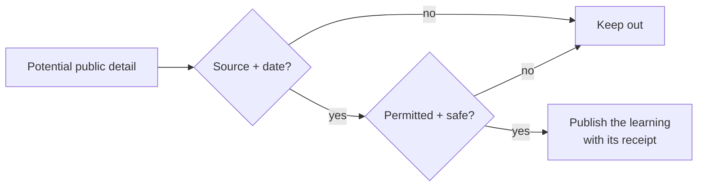

# Public Boundary / Editorial Safety

> This repository is a public portfolio, not a competition workspace. The goal is to expose judgement and proof, not the sauce.

## Safe to publish

- Public Kaggle profile links, public competition pages, and dated statistics with a source.
- Public notebooks, datasets, and discussions when their licenses and competition rules allow it.
- High-level descriptions of validation, experimentation, and infrastructure decisions.
- Aggregated lessons after a competition permits disclosure.

## Never publish here

- Credentials, API tokens, cookies, session files, SSH material, or environment files.
- Private data, unpublished notebooks, private model weights, or customer material.
- Active-competition submissions, inference artifacts, ensemble weights, or tactics when rules or timing restrict them.
- Rankings, medals, placements, or metrics that have not been verified against a dated public source.

## Review gate

Before every update: check source, date, permission, and whether the detail would give away proprietary or competition-sensitive work. When in doubt, show the method and learning—not the artifact.

---

← [README](README.md) · [Evidence ledger](docs/EVIDENCE_LEDGER.md) · [Competition atlas](docs/COMPETITION_INDEX.md) →
