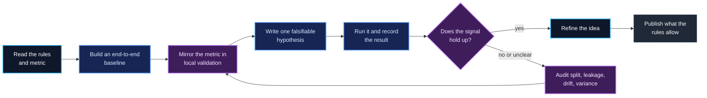
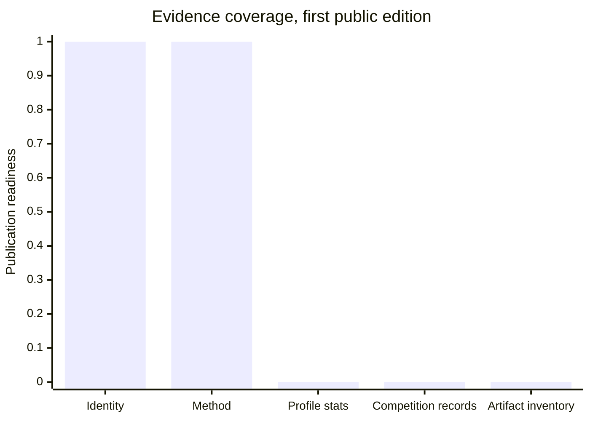
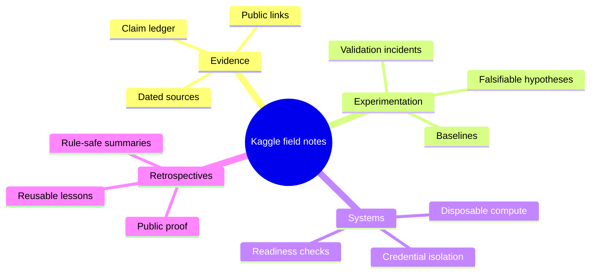

# Kaggle / field notes

A public research portfolio for competitive machine learning. It records the method behind the work: the baseline, the validation checks, the experiments that failed, and the results once they can be pointed at.

  

Diagram of the method. Drawn for this repository, not a screenshot of a run.

Profile: [kaggle.com/pascalledesma](https://www.kaggle.com/pascalledesma)

## Where to read

| File | What it holds |
| :-- | :-- |
| [docs/EVIDENCE_LEDGER.md](docs/EVIDENCE_LEDGER.md) | Each claim, its source, the date it was read |
| [docs/JOURNEY.md](docs/JOURNEY.md) | How the practice moved from disconnected runs to a repeatable routine |
| [docs/EXPERIMENT_LEARNING_MAP.md](docs/EXPERIMENT_LEARNING_MAP.md) | How a hypothesis gains or loses confidence |
| [docs/COMPETITION_INDEX.md](docs/COMPETITION_INDEX.md) | The format for a competition record, published after review |
| [data/public-profile-snapshot.csv](data/public-profile-snapshot.csv) | A sparse, dated data layer |

## What is verified

The public account at [kaggle.com/pascalledesma](https://www.kaggle.com/pascalledesma) exists and is mine. The engineering practice is documented: disposable compute, credential isolation, readiness checks, a baseline before any model tuning, and a validation routine that tries to break the split before trusting it.

Current rank, medals, points, placements, scores, competition dates and notebook counts are not stated here. Each of those moves from blank to visible through a dated source in the [evidence ledger](docs/EVIDENCE_LEDGER.md), and not before.

## The loop

A higher number is not the only output. The other one is a chain of reasoning that survives someone trying to break it.

## What is public right now

| Signal | State | What it means | Gate |
| :-- | :--: | :-- | :-- |
| Profile identity | Verified | The Kaggle account is linked above. | Public profile |
| Competition stats | Awaiting capture | No rank, medals, points or counts are claimed. | Dated profile export |
| Competition records | Awaiting inventory | No names or placements are inferred from memory. | Public result page |
| Notebooks and datasets | Awaiting inventory | No artifact catalogue is implied. | Public artifact links |
| Experiment method | Documented | The baseline, validation and review loops are written down. | Public-safe engineering notes |

This chart measures coverage, not performance. A zero means not yet evidenced.

## The four stations

| Station | The question it asks | Read |
| :-- | :-- | :-- |
| Evidence | Can a reader verify this? | [Evidence ledger](docs/EVIDENCE_LEDGER.md) |
| Experimentation | What did the test actually teach? | [Experiment learning map](docs/EXPERIMENT_LEARNING_MAP.md) |
| Systems | Could the loop be repeated safely? | [Research journey](docs/JOURNEY.md) |
| Retrospectives | What is safe and useful to share? | [Competition index](docs/COMPETITION_INDEX.md) |

## The publishing rule

A page, number, chart or link goes public only after the [evidence ledger](docs/EVIDENCE_LEDGER.md) and the [public boundary](PUBLIC_BOUNDARIES.md) are both satisfied: source, date, permission, competition sensitivity. That keeps the private operating manual private, and keeps this repository readable by someone with no context.

<a href="docs/EVIDENCE_LEDGER.md">Evidence ledger</a> · <a href="docs/JOURNEY.md">Journey</a> · <a href="docs/EXPERIMENT_LEARNING_MAP.md">Experiment map</a> · <a href="docs/COMPETITION_INDEX.md">Competition index</a> · <a href="PUBLIC_BOUNDARIES.md">Public boundaries</a>

