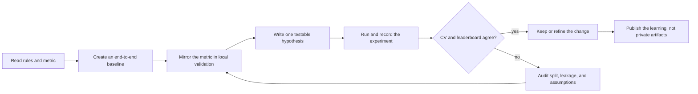
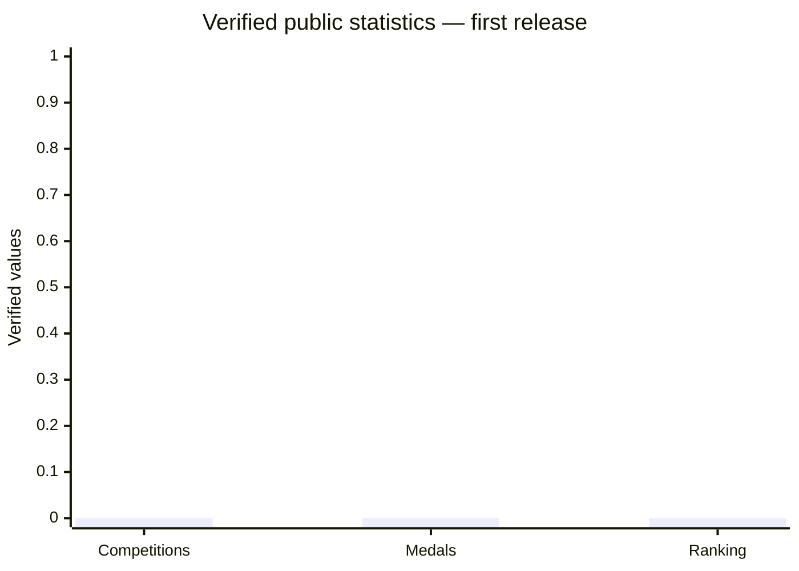
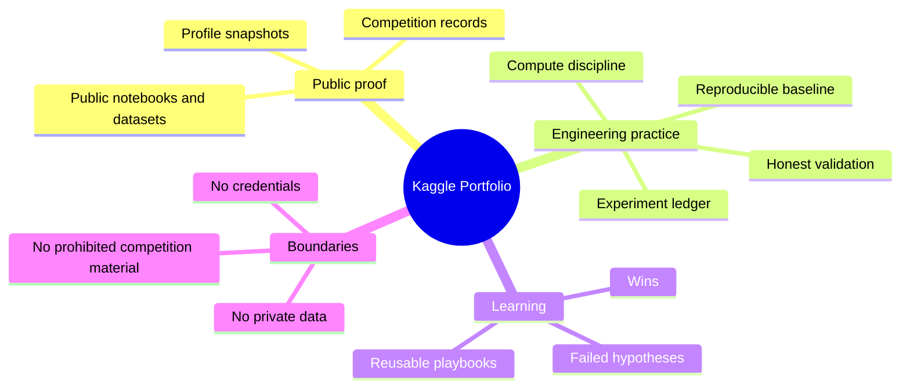

# Kaggle Portfolio

> A public record of how Pascal approaches competitive machine learning: build a credible baseline, make validation honest, run one deliberate experiment at a time, and preserve the lesson whether the score rises or falls.

## What this is

This is not a dump of notebooks or a claim sheet. It is a navigable, public-safe map of the work: competition discipline, validation practice, experimentation patterns, and the operating systems that made iteration more repeatable.

| Start here | What it answers |
| --- | --- |
| [Evidence ledger](docs/EVIDENCE_LEDGER.md) | What is verified today—and what is intentionally still blank. |
| [Journey](docs/JOURNEY.md) | The progression from compute and experiment operations to competition-ready loops. |
| [Experiment learning map](docs/EXPERIMENT_LEARNING_MAP.md) | How hypotheses become evidence without confusing CV with leaderboard signal. |
| [Competition index](docs/COMPETITION_INDEX.md) | The public record format for individual competitions. |
| [Data guide](data/public-profile-snapshot.csv) | The small source file that powers public profile statistics when verified. |

## The operating loop

The useful signal is not merely a high score. It is being able to explain what changed, why it was tested, what the validation said, and whether the leaderboard confirmed it.

## Public profile snapshot

The Kaggle account is publicly identifiable as [Pascal](https://www.kaggle.com/pascalledesma). This repository deliberately does **not** guess at current rank, medals, points, competition placements, or submission counts. Those values change, and no verified export was available at the time of this first release.

The chart is an explicit **data-quality placeholder**, not a claim of zero activity. Once a dated public-profile capture is checked in, it will be replaced with the real values and source links. See [the evidence ledger](docs/EVIDENCE_LEDGER.md).

## What is already evidenced

The initial release can safely show the system behind the work:

- A GPU-backed Kaggle rig with credential isolation, disposable compute, and readiness checks.
- A competition doctrine that treats rules, metric alignment, baseline creation, and CV-versus-leaderboard drift as first-class engineering concerns.
- A structured knowledge model for CV, audio, tabular, ARC-style reasoning, compute limits, and submission discipline.

It does **not** yet claim individual results. Public evidence arrives as dated records, not convenient memory.

## Portfolio structure

## The record we are building

Each public competition page will answer five questions:

1. What problem and metric mattered?
2. What did the first credible baseline establish?
3. Which hypotheses were tested, and what did they teach?
4. What publicly verifiable outcome can be linked?
5. What details remain private, rule-bound, or intentionally omitted?

That makes the portfolio useful to a hiring manager or collaborator without leaking an active competition strategy.

## Contributing public evidence

Use the [evidence ledger](docs/EVIDENCE_LEDGER.md) before adding a number or an achievement. The standard is simple: a public URL, a dated screenshot/export, or a reproducible source file. If it cannot be checked, label it as a future slot rather than presenting it as fact.

## Public boundary

Read [PUBLIC_BOUNDARIES.md](PUBLIC_BOUNDARIES.md) before adding notebooks, artifacts, or competition writeups. The repository deliberately excludes keys, private datasets, unreleased models, active-competition material, and any content restricted by Kaggle rules.

---

**Related:** [Evidence ledger](docs/EVIDENCE_LEDGER.md) · [Journey](docs/JOURNEY.md) · [Experiment learning map](docs/EXPERIMENT_LEARNING_MAP.md) · [Competition index](docs/COMPETITION_INDEX.md)
