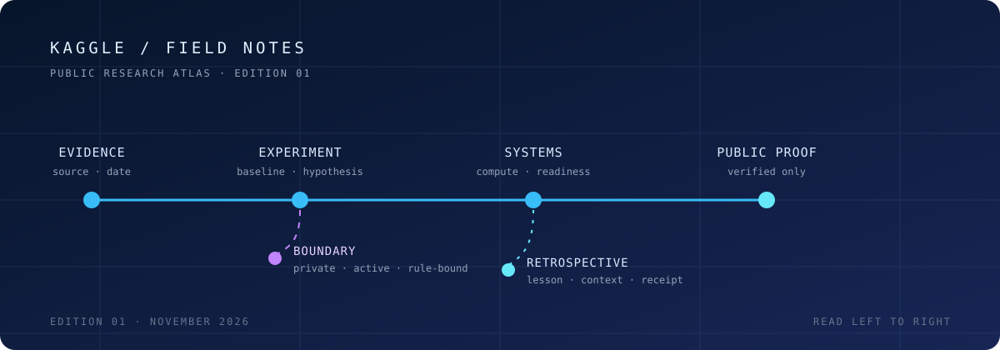
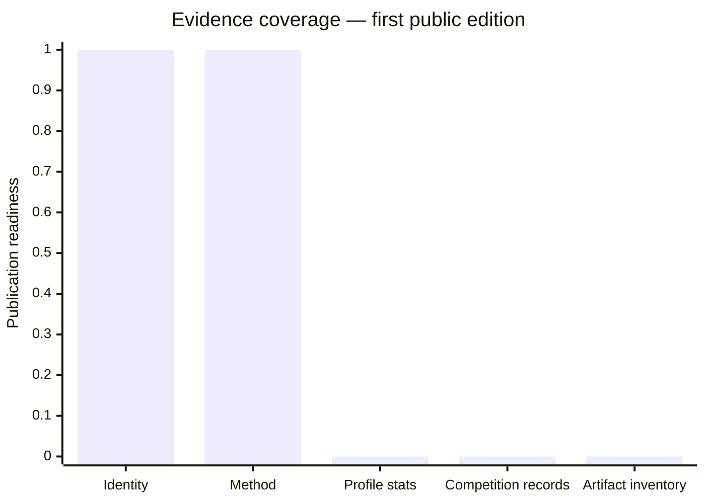
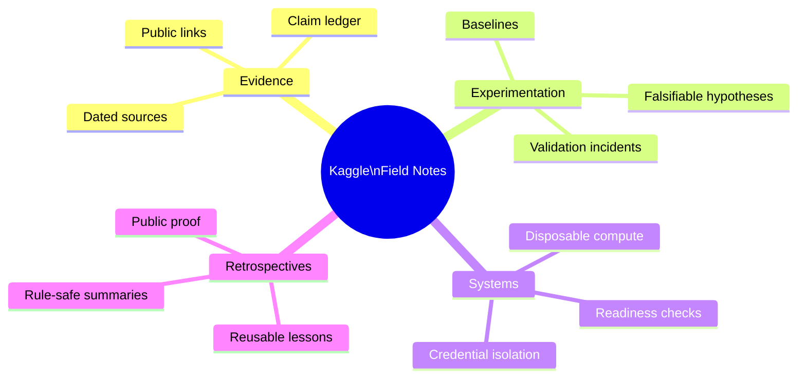

# KAGGLE / FIELD NOTES

> **A public research portfolio for competitive machine learning.**
>
> Not a trophy cabinet. Not a notebook dump. A living record of how a serious practice is built: establish the baseline, challenge the validation, preserve the learning, then earn the right to make a claim.

  

  
  
  

---

## Enter the research room

| Read this | You will find | Why it exists |
| :-- | :-- | :-- |
| **[01 · Evidence ledger](docs/EVIDENCE_LEDGER.md)** | The difference between verified signal and future evidence. | Keeps the portfolio honest when the internet is vague. |
| **[02 · Research journey](docs/JOURNEY.md)** | The evolution from runs to a repeatable practice. | Gives the work a narrative without inventing a scoreboard. |
| **[03 · Experiment map](docs/EXPERIMENT_LEARNING_MAP.md)** | How a hypothesis earns, loses, or revises confidence. | Makes method visible. |
| **[04 · Competition atlas](docs/COMPETITION_INDEX.md)** | The structure for public, post-review competition records. | Makes future depth navigable. |
| **[05 · Source snapshot](data/public-profile-snapshot.csv)** | A deliberately sparse, dated data layer. | Makes omissions explicit rather than decorative. |

<strong>What is verified right now?</strong>

The public Kaggle account is identifiable as [Pascal](https://www.kaggle.com/pascalledesma). This first release also documents the engineering practice behind the work: disposable compute, credential isolation, readiness checks, baseline-first experiments, and validation discipline.

It does **not** claim current rank, medals, points, placements, scores, competition dates, or notebook inventory. Those move from blank to visible only through a dated source in the [evidence ledger](docs/EVIDENCE_LEDGER.md). Restraint: still a feature, even on GitHub.

---

## The machine behind the learning

The artifact is not merely a higher number. It is a chain of reasoning that can survive someone trying to break it.

---

## Research surface · current edition

| Signal | Public state | What it means | Evidence gate |
| :-- | :--: | :-- | :-- |
| Profile identity | **Verified** | The public Kaggle identity is linked above. | Public profile |
| Competition stats | **Awaiting capture** | No ranks, medals, points, or counts are claimed. | Dated profile export |
| Competition records | **Awaiting inventory** | No names or placements are inferred from memory. | Public result or team page |
| Public notebooks / datasets | **Awaiting inventory** | No artifact catalogue is implied. | Public artifact links |
| Experiment doctrine | **Documented** | Baseline, validation, and learning loops are recorded. | Public-safe engineering evidence |

This is a coverage chart, not a performance chart. A zero here means **not yet evidenced**, not “nothing happened.”

---

## Four stations, one discipline

| Station | The question it asks | Explore |
| :-- | :-- | :-- |
| **Evidence** | “Can a reader verify this?” | [Evidence ledger](docs/EVIDENCE_LEDGER.md) |
| **Experimentation** | “What did the test actually teach?” | [Experiment learning map](docs/EXPERIMENT_LEARNING_MAP.md) |
| **Systems** | “Could the loop be repeated safely?” | [Research journey](docs/JOURNEY.md) |
| **Retrospectives** | “What is safe and useful to share?” | [Competition atlas](docs/COMPETITION_INDEX.md) |

---

## The public contract

The useful story is the **problem → decisive test → lesson → proof**. The private operating manual remains private.

Before a new page, number, chart, or link is published, it passes the [evidence ledger](docs/EVIDENCE_LEDGER.md) and the [public boundary](PUBLIC_BOUNDARIES.md): source, date, permission, and competition sensitivity. This keeps the portfolio legible to collaborators and useful to future me without leaking credentials, private data, unreleased models, or live competition strategy.

---

  <strong>Begin with the evidence. Follow the learning. Add the results when they can be proved.</strong> 
  [Evidence ledger](docs/EVIDENCE_LEDGER.md) · [Journey](docs/JOURNEY.md) · [Experiment map](docs/EXPERIMENT_LEARNING_MAP.md) · [Competition atlas](docs/COMPETITION_INDEX.md) · [Public boundaries](PUBLIC_BOUNDARIES.md)

