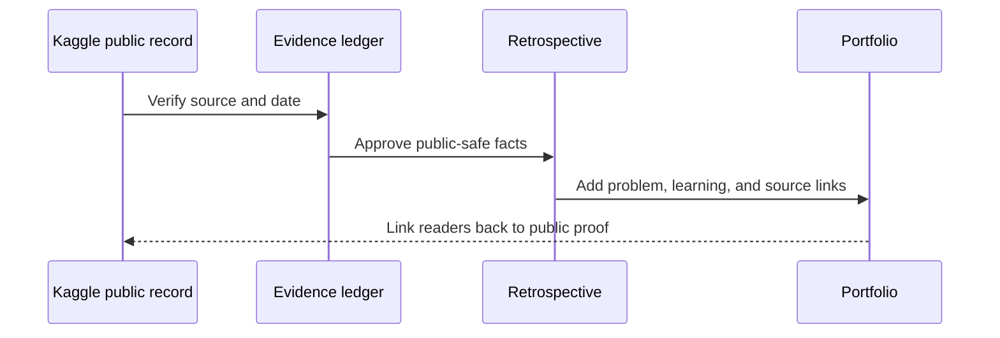

# 04 · Competition Atlas

> **A future-facing structure for work that has earned a public retrospective.**

No individual competition rows are published in this first edition: names, dates, placements, and disclosure permissions are not yet verified from public sources. This is intentional. An empty atlas is more credible than a populated fiction.

## Entry template

| Field | What belongs here |
| --- | --- |
| Competition | Public Kaggle competition link. |
| Status | Active, completed, or retrospective-ready. |
| Problem / metric | Plain-language scope and official metric. |
| Public outcome | Only a source-backed placement, medal, score, or public notebook. |
| Learning | One concise reusable lesson. |
| Boundary | What remains private, time-sensitive, or rule-bound. |

## Publication state · edition 01

| Competition | Status | Public evidence | Notes |
| --- | --- | --- | --- |
| Future verified entry | Awaiting source | None yet | Placeholder only; not a claim. |

## Retrospective sequence

## What a strong retrospective feels like

| Show the reader | Keep private or rule-bound |
| :-- | :-- |
| The problem, metric, constraints, and public source. | Credentials, private data, live strategy, or prohibited material. |
| A concise baseline-to-learning narrative. | Active submission tactics, ensemble details, or unreleased model internals. |
| The public result when it can be checked. | Any rank, score, or placement that is merely remembered. |

The finished page should give a collaborator a useful technical signal in two minutes—and a route to inspect the evidence in ten.

---

← [Experiment map](EXPERIMENT_LEARNING_MAP.md) · [Evidence ledger](EVIDENCE_LEDGER.md) · [Public boundaries](../PUBLIC_BOUNDARIES.md) · [README](../README.md) →
