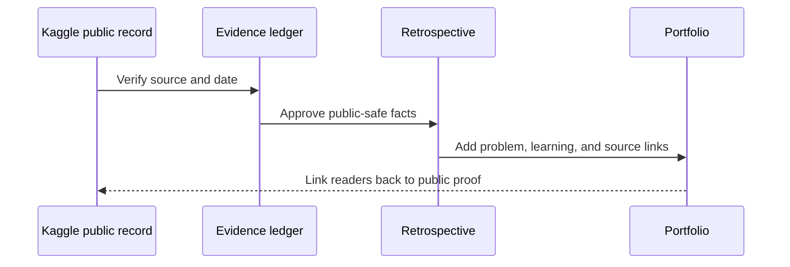

# Competition Index

No individual competition rows are published in the first release because their names, dates, placements, and permission to disclose have not yet been verified from public sources.

## Entry template

| Field | What belongs here |
| --- | --- |
| Competition | Public Kaggle competition link. |
| Status | Active, completed, or retrospective-ready. |
| Problem / metric | Plain-language scope and official metric. |
| Public outcome | Only a source-backed placement, medal, score, or public notebook. |
| Learning | One concise reusable lesson. |
| Boundary | What remains private, time-sensitive, or rule-bound. |

## Publication state

| Competition | Status | Public evidence | Notes |
| --- | --- | --- | --- |
| Future verified entry | Awaiting source | None yet | Placeholder only; not a claim. |

## Retrospective sequence

---

← [README](../README.md) · [Evidence ledger](EVIDENCE_LEDGER.md) · [Public boundaries](../PUBLIC_BOUNDARIES.md)
