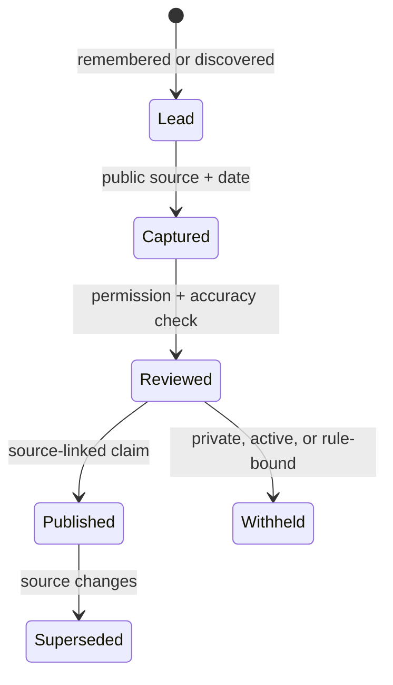

# 01 · Evidence Ledger

Last reviewed: 2026-08-08

> **Every strong public claim has a source, date, and permission boundary.**

This ledger is the source of truth for public claims in the repository. It is deliberately visible: readers can see the difference between what is known, what awaits capture, and what should never be published.

| Claim area | Current status | Evidence | Publication rule |
| --- | --- | --- | --- |
| Kaggle profile identity | Verified | [Public Kaggle profile](https://www.kaggle.com/pascalledesma) identifies the account as Pascal. | Link is safe. |
| Current rank / tier | Not yet captured | No dated profile export checked in. | Add only with a dated public capture. |
| Medals / points | Not yet captured | No dated profile export checked in. | Add only with a dated public capture. |
| Competition placements | Not yet captured | No competition result source checked in. | One row per public source. |
| Public notebooks / datasets | Not yet inventoried | Profile identity is known; inventory remains open. | Link only to public artifacts. |
| Kaggle rig practice | Verified as internal engineering evidence | Local rig design and operating doctrine. | Describe practice; never copy credentials or active materials. |

## Source hierarchy

1. Kaggle public profile, competition, notebook, or dataset URL.
2. A dated screenshot/export of a public Kaggle page, committed only if it contains no private material.
3. A reproducible script that retrieves a public value, with the date it was retrieved.

Everything else is a research lead, not a portfolio fact.

## Update protocol

1. Capture the source URL and date.
2. Add the value to `data/public-profile-snapshot.csv`.
3. Update the README chart and relevant competition page.
4. Check all links and re-read [the public boundary](../PUBLIC_BOUNDARIES.md).

## Claim lifecycle

No source, no claim. No exception merely because the story would look better with one.

---

← [README](../README.md) · [Journey](JOURNEY.md) · [Competition atlas](COMPETITION_INDEX.md) · [Public boundaries](../PUBLIC_BOUNDARIES.md) →
