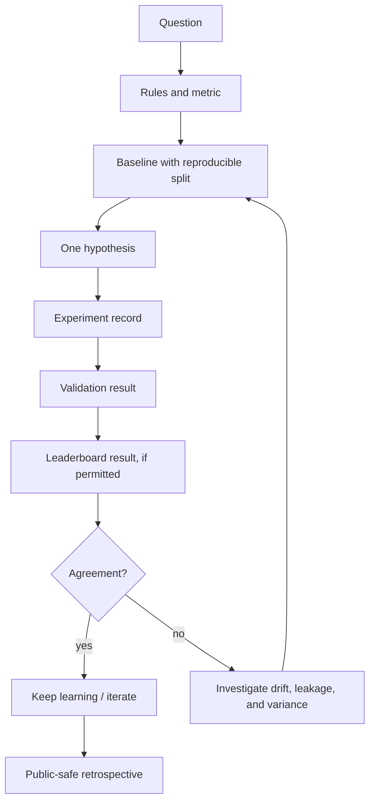

# 03 · Experiment Learning Map

> **The work is a sequence of questions, not a pile of model runs.**

This map describes the public-safe reasoning shape behind experimentation. It is intentionally domain-flexible: tabular, vision, audio, ARC-style reasoning, and infrastructure each need different techniques; they all need an honest validation loop.

## What an honest experiment contains

## Research stations

| Area | Reusable habit | Portfolio-friendly proof |
| --- | --- | --- |
| Tabular | Strong baseline, robust folds, feature audit. | Post-competition retrospective. |
| Computer vision | Controlled augmentations and resolution tradeoffs. | Public notebook or permitted summary. |
| Audio | Data-aware validation and calibration checks. | Permitted experiment chart. |
| ARC-style reasoning | Test-time constraints and evaluation discipline. | Public formulation, never active artifacts. |
| Infrastructure | Disposable compute and readiness checks. | Architecture description without secrets. |

## Why CV-versus-leaderboard drift gets its own branch

When cross-validation and leaderboard outcomes disagree, the response is not to try more models blindly. The response is to inspect split design, leakage risk, data shift, and variance. That is a stronger story than a convenient metric.

## The test-honesty checklist

| Before trusting an apparent win | The adversarial question |
| :-- | :-- |
| Split design | Does the validation split reflect the real evaluation regime? |
| Leakage | Could any feature, preprocessing step, or grouping rule reveal the answer? |
| Variance | Is this result robust across folds, seeds, or a reasonable perturbation? |
| Metric alignment | Does local evaluation match the official objective and decision threshold? |
| Public claim | Is this result permitted and independently sourceable? |

The portfolio preserves the question and the lesson even when the raw artifacts must remain private.

---

← [Journey](JOURNEY.md) · [Competition atlas](COMPETITION_INDEX.md) · [Evidence ledger](EVIDENCE_LEDGER.md) · [README](../README.md) →
