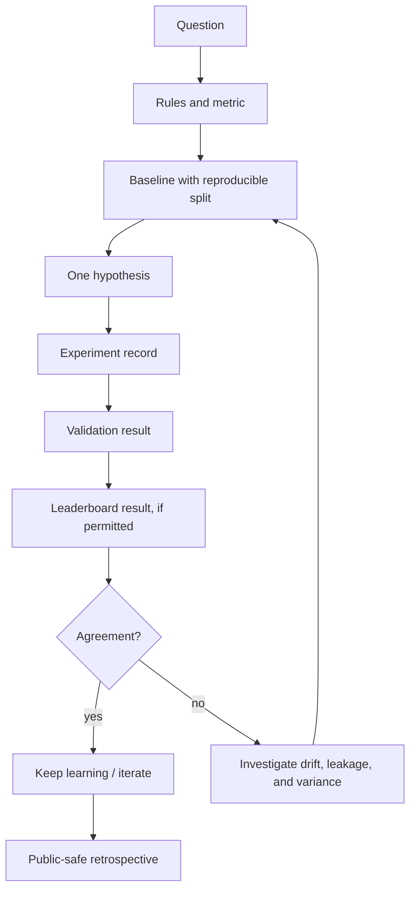

# Experiment Learning Map

## What an honest experiment contains

## Practice map

| Area | Reusable habit | Portfolio-friendly proof |
| --- | --- | --- |
| Tabular | Strong baseline, robust folds, feature audit. | Post-competition retrospective. |
| Computer vision | Controlled augmentations and resolution tradeoffs. | Public notebook or permitted summary. |
| Audio | Data-aware validation and calibration checks. | Permitted experiment chart. |
| ARC-style reasoning | Test-time constraints and evaluation discipline. | Public formulation, never active artifacts. |
| Infrastructure | Disposable compute and readiness checks. | Architecture description without secrets. |

## Why CV-versus-leaderboard drift gets its own branch

When cross-validation and leaderboard outcomes disagree, the response is not to try more models blindly. The response is to inspect split design, leakage risk, data shift, and variance. That is a stronger story than a convenient metric.

---

← [Journey](JOURNEY.md) · [Competition index](COMPETITION_INDEX.md) · [README](../README.md)
