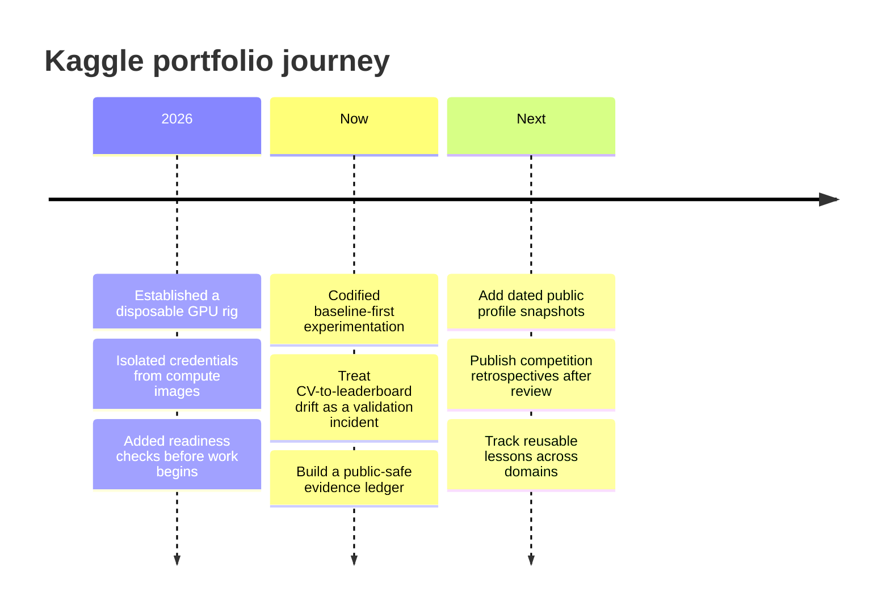
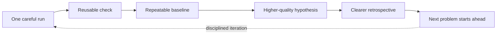

# 02 · Research Journey

> **From runs to a repeatable practice.** This is the operational history behind the portfolio—not a substitute for verified competition results.

The first public edition records the engineering trajectory while leaving unverified outcomes deliberately outside the narrative. It shows how work becomes easier to trust: a safer run surface, a credible baseline, and a learning loop that survives disagreement.

## Growth signals we will track

| Signal | Why it matters | Evidence requirement |
| --- | --- | --- |
| Public profile stats | A snapshot of external participation. | Dated profile source. |
| Competition records | Context for outcome claims. | Public competition result or public team page. |
| Experiment discipline | Whether learning survives each run. | Public-safe retrospective. |
| Reusable playbooks | Evidence of compounding practice. | Versioned documentation with sources. |

Growth is more than a leaderboard position. The durable asset is a practice that can reproduce a credible baseline, learn from disagreement, and carry the lesson into the next problem.

## A research practice compounds

The point is not to make every experiment look successful. It is to make the next experiment better informed.

---

← [README](../README.md) · [Experiment map](EXPERIMENT_LEARNING_MAP.md) · [Evidence ledger](EVIDENCE_LEDGER.md) · [Competition atlas](COMPETITION_INDEX.md) →
