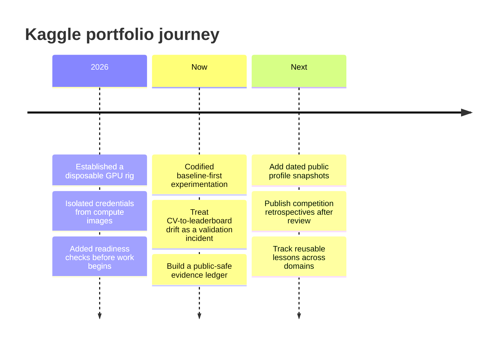

# Journey: From Runs to a Repeatable Practice

The first public release records the engineering trajectory, while leaving unverified competition outcomes out of the narrative.

## Growth signals we will track

| Signal | Why it matters | Evidence requirement |
| --- | --- | --- |
| Public profile stats | A snapshot of external participation. | Dated profile source. |
| Competition records | Context for outcome claims. | Public competition result or public team page. |
| Experiment discipline | Whether learning survives each run. | Public-safe retrospective. |
| Reusable playbooks | Evidence of compounding practice. | Versioned documentation with sources. |

Growth is more than a leaderboard position. The durable asset is a practice that can reproduce a credible baseline, learn from disagreement, and carry the lesson into the next problem.

---

← [README](../README.md) · [Experiment learning map](EXPERIMENT_LEARNING_MAP.md) · [Evidence ledger](EVIDENCE_LEDGER.md)
